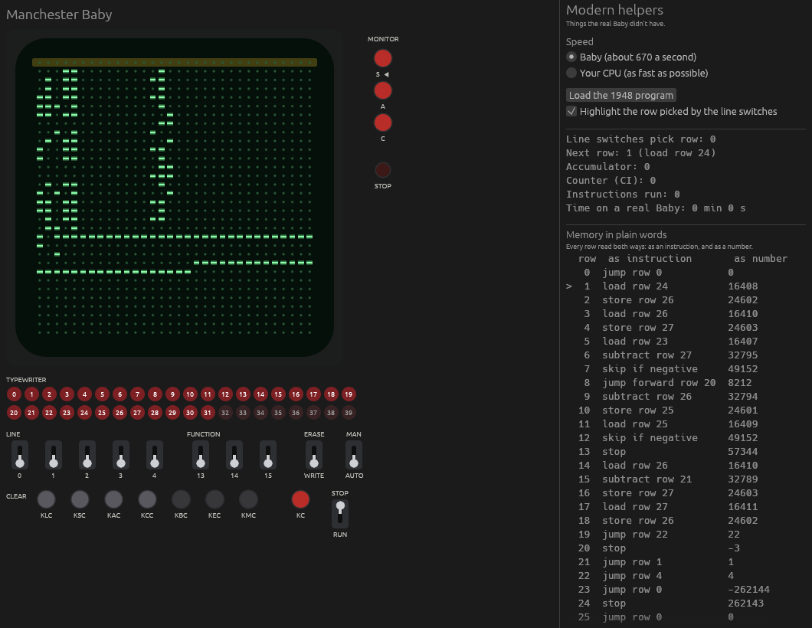

# Manchester Baby

An emulator of the **Manchester Baby**, the first computer to run a program stored in its own memory. It ran its first program on 21 June 1948 at the University of Manchester.

Written in Rust, with a desktop window that recreates the Baby's display tube and control panel.



## What the Baby was

The Baby (officially the Small Scale Experimental Machine) was built by Freddie Williams, Tom Kilburn and Geoff Tootill to test a new kind of memory: the **Williams tube**, which stored bits as tiny charges on the screen of a cathode ray tube.

Earlier computers kept their programs outside the machine, as cables, switches or punched tape. The Baby was the first to keep its program in the same memory as its numbers, which is how every computer since has worked.

It had:

- **32 rows of memory**, each 32 bits (128 bytes in total)
- **An accumulator**, where every calculation happens
- **A counter (CI)**, which holds the row the CPU is up to
- **7 instructions**, and about 550 vacuum tubes doing the work

## What's emulated

- All 7 instructions, including the quirk where instruction 5 is a second subtract
- 32 bit arithmetic that wraps around like the real hardware
- The display tube, following the real rules for each monitor setting
- The control panel, with only the controls the real Baby had
- The original 1948 program, which finds 131,072 in exactly 2,097,154 instructions, the same as the real run

## Running it

You need [Rust](https://rustup.rs). On Windows you also need the Visual Studio C++ build tools:

```
winget install Rustlang.Rustup
winget install Microsoft.VisualStudio.2022.BuildTools --override "--wait --passive --add Microsoft.VisualStudio.Workload.VCTools --includeRecommended"
```

Then from the project folder:

```
cargo run
```

The first build takes a minute or two.

To check the 1948 program still gets the right answer:

```
cargo test
```

## The window

The left side is the machine, 1:1 with the real Baby. The right side is modern helpers the real Baby never had.

### The machine

| Control | What it does |
|---|---|
| **Display tube** | Shows one of the three memory tubes as dashes (1) and dots (0), smallest bit on the left |
| **S, A, C** | Monitor buttons. Pick what the tube shows: the **store** (RAM), the **accumulator** (repeated on every line), or **control** (the counter, alternating with the present instruction while running) |
| **Stop lamp** | Lights up when the program reaches a stop instruction |
| **Typewriter** | Sets or clears one bit of the row picked by the line switches. Buttons 32 to 39 weren't connected on the real Baby |
| **Line switches 0 to 4** | Pick a row, in binary. Switch 0 is worth 1, switch 4 is worth 16 |
| **Function switches 13 to 15** | Pick an instruction by hand, for manual mode |
| **ERASE / WRITE** | Whether the typewriter clears bits or sets them |
| **MAN / AUTO** | Manual runs the instruction set on the switches. Auto runs the program from memory |
| **KLC** | Clears the row picked by the line switches |
| **KSC** | Clears all of memory |
| **KAC** | Clears the accumulator |
| **KCC** | Clears the counter, the present instruction and the accumulator |
| **KBC, KEC, KMC** | Never connected on the real Baby |
| **KC** | Runs one instruction, and clears the stop lamp |
| **STOP / RUN** | The run switch |

### Modern helpers

- **Speed:** Baby speed (about 670 instructions a second, so the 1948 program takes the real 52 minutes) or as fast as your CPU can go
- **Load the 1948 program** at any time
- A highlight on the row picked by the line switches
- Readouts for the counter, accumulator, instructions run, and how long a real Baby would have taken
- Every row of memory shown both as an instruction and as a number

### Punching in your own bits

1. Set the run switch to **STOP**
2. Flip the line switches to pick a row
3. Click typewriter buttons to set bits in that row
4. Flip **ERASE** up to clear bits instead

## The instructions

Each instruction row has two parts: bits 0 to 4 say **which row**, and bits 13 to 15 say **which instruction**.

| Number | Instruction | What it does |
|---|---|---|
| 0 | Jump | Set the counter to the number in the row |
| 1 | Jump forward | Add the number in the row to the counter |
| 2 | Load | Copy the row into the accumulator, flipped negative |
| 3 | Store | Copy the accumulator into the row |
| 4, 5 | Subtract | Take the row's number away from the accumulator |
| 6 | Skip if negative | If the accumulator is negative, skip the next row |
| 7 | Stop | Halt the machine and light the stop lamp |

Before every instruction, the CPU adds 1 to the counter and reads that row. Jumps are the only way to change that order, which is how programs loop.

## The 1948 program

Tom Kilburn's program finds the biggest number that divides 262,144 exactly, other than 262,144 itself. The Baby had no divide, so it tries every number from 262,143 downwards, subtracting each one over and over to see if it lands exactly on 0.

| Rows | What they do |
|---|---|
| 1 to 5 | Setup |
| 6 to 8 | Keep subtracting the number being tried until the accumulator goes negative |
| 9 to 13 | Work out the remainder. If it's 0, stop |
| 14 to 19 | Try the next number down and start again |
| 20 to 24 | Numbers the program uses |
| 25 to 27 | Working space. When the program stops, row 27 holds the answer |

The real run took 52 minutes. The point wasn't the answer, it was proving the memory could run for that long without losing a single bit.

## Project layout

| File | What it is |
|---|---|
| `src/memory.rs` | The RAM: 32 rows of 32 bits |
| `src/cpu.rs` | The counter, the present instruction, the accumulator, and the 7 instructions |
| `src/programs.rs` | The 1948 program, plus a test that it finds 131,072 |
| `src/display.rs` | Turns an instruction into readable text |
| `src/gui.rs` | The window, the control panel logic and the speed settings |
| `src/gui/tube.rs` | Draws the display tube |
| `src/gui/controls.rs` | Draws the switches, keys and lamps |

## Sources

- [The Manchester Small Scale Experimental Machine: programmer's reference](https://curation.cs.manchester.ac.uk/computer50/www.computer50.org/mark1/prog98/ssemref.html)
- [Manchester Baby Simulator user guide, David Sharp](https://www.davidsharp.com/baby/babyuserguide.pdf)
- [The Baby, University of Manchester](https://www.curation.cs.manchester.ac.uk/digital60/www.digital60.org/birth/thebaby/index.html)
